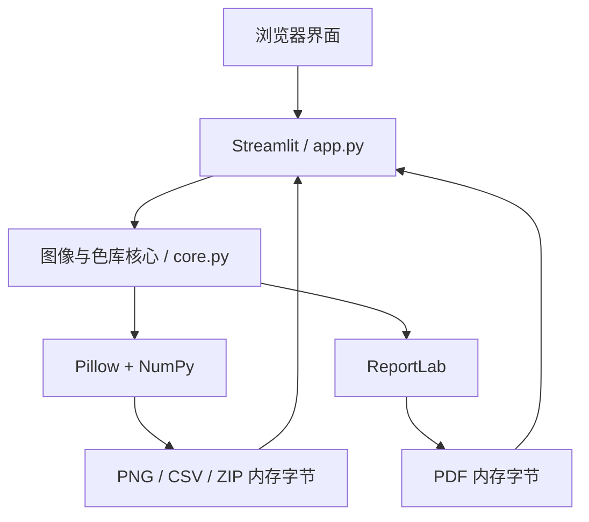
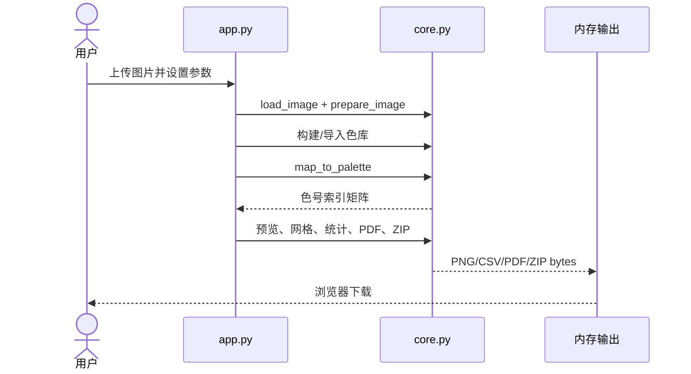

# 拼豆图生成器开发文档

> 文档版本：1.1
> 对应代码：当前 `app.py` / `core.py` 实现  
> 更新日期：2026-09-06  
> 适用读者：开发、测试、维护和二次开发人员

## 1. 系统概览

本项目是单进程 Python 网页应用。Streamlit 提供上传、参数控件、结果预览和下载；Pillow 与 NumPy 负责图片预处理、量化及像素映射；ReportLab 负责生成 A4 分页 PDF。所有生成结果保存在当前 Streamlit 会话内存中，不写入数据库，也不依赖外部 API。



## 2. 运行环境

### 2.1 版本要求

- Python 3.10 或更高版本。
- 现代桌面浏览器。
- 首次安装依赖时需要能访问 Python 包索引；安装完成后核心处理无需联网。

### 2.2 Python 依赖

| 依赖 | 版本范围 | 用途 |
| --- | --- | --- |
| `streamlit` | `>=1.63,<2` | 网页界面、会话状态、文件上传和下载 |
| `Pillow` | `>=10.4,<13` | 图像解码、方向修正、缩放、量化、绘图和 PNG 编码 |
| `numpy` | `>=1.26,<3` | 像素矩阵、颜色空间转换、距离计算和计数 |
| `reportlab` | `>=4.2,<5` | A4 PDF、分页网格和色表生成 |
| `pillow-heif` | `>=0.18,<2` | 可选 HEIC/HEIF 解码器注册 |
| `openpyxl` | `>=3.1.5,<4` | Python 应用运行时的 XLSX 单元格、样式和工作簿导出 |

### 2.3 Excel 导出增量（v1.1）

新增 `excel_export.py`，入口为 `make_xlsx(indices, palette, show_codes=True) -> bytes`。直接消费未放大的色库索引矩阵，不从 PNG 回读、采样或插入图片。`indices[y, x]` 映射到 Excel 第 `y+1` 行、第 `x+1` 列，图案左上角为 A1。

使用填充色、黑白对比文字、居中及 shrink-to-fit 呈现像素；近似 32 px 宽、24 pt 高，每五格加粗边界。图纸页无标题偏移、合并或辅助数据。色号、品牌、名称写为显式字符串，避免公式注入及前导零丢失。输入须为非空二维整数矩阵，尺寸不超过 300×300，索引须在色库范围内。

第二张“色号统计”表复用 `usage_rows()` 的生成时数量，合计使用 SUM 公式（Excel 打开时计算）。手工修改图纸颜色或色号不会重算各色数量；这是快照而非库存管理表。

`app.py` 在生成阶段创建 XLSX，将其存入 `result["xlsx"]`，以 Office Open XML MIME 提供下载。`make_bundle()` 新增可选尾参数 `xlsx_bytes=None`，传入时增加 `bead_pattern.xlsx`，旧调用保持兼容。旧会话不含 XLSX 时提示重新生成。

安装依赖后运行以下回归测试：

```bash
python test_core.py
python -m unittest test_excel -v
python test_app.py
```

Excel 测试覆盖非方形逐像素映射、颜色、前导零、公式注入防护、隐藏色号、跨品牌重复色号、300×300 最大网格、无效输入及 ZIP 字节一致性。

## 3. 目录结构

```text
bead_maker/
├── app.py                    # Streamlit 页面与交互编排
├── core.py                   # 图像、色库、匹配、统计和导出核心
├── requirements.txt          # 运行依赖
├── requirements-dev.txt      # 调试依赖（含运行依赖）
├── README.md                 # 用户安装与使用说明
├── sample_palette.csv        # 自定义色库示例
├── start_windows.bat         # Windows 一键启动脚本
├── debug_windows.bat         # Windows debugpy 启动脚本
├── start_macos_linux.sh      # macOS/Linux 启动脚本
├── test_core.py              # 核心烟雾测试
└── docs/
    ├── PRD.md                # 产品需求文档
    └── DEVELOPMENT.md        # 本开发文档
```

## 4. 快速开始

### 4.1 Windows

可双击 `start_windows.bat`，或手工执行：

```bat
python -m venv .venv
.venv\Scripts\activate
python -m pip install -r requirements.txt
python -m streamlit run app.py
```

启动脚本会优先使用 Windows Python Launcher `py`，否则使用 `python`；虚拟环境存在时不会重复创建，但每次会检查依赖。

### 4.2 macOS / Linux

```bash
python3 -m venv .venv
source .venv/bin/activate
python -m pip install -r requirements.txt
python -m streamlit run app.py
```

也可以执行：

```bash
./start_macos_linux.sh
```

## 5. 运行时数据流



详细步骤：

1. `st.file_uploader` 将上传文件读为 `bytes`。
2. `load_image()` 解码第一帧、检查像素数并修正 EXIF 方向。
3. `prepare_image()` 合成透明背景、调整对比度/饱和度，再按目标网格缩放。
4. UI 根据模式调用 `builtin_palette()`、`extract_palette()` 或 `parse_palette_csv()`。
5. `map_to_palette()` 将每个目标像素映射为色库索引，形成 `rows × columns` 的 `int16` 数组。
6. 该索引矩阵作为单一事实来源，分别生成预览、带格图、统计、PDF 和 ZIP。
7. 二进制结果放入 `st.session_state["result"]`，供页面切换和下载按钮复用。

## 6. 数据模型

### 6.1 `BeadColor`

定义位置：`core.py`。

```python
@dataclass(frozen=True)
class BeadColor:
    code: str
    name: str
    r: int
    g: int
    b: int
    brand: str = "通用"
```

派生属性：

- `rgb -> tuple[int, int, int]`：返回用于 Pillow、NumPy 和 ReportLab 的 RGB 元组。
- `hex -> str`：返回大写 `#RRGGBB`。

对象为不可变数据类，便于安全地在色库、统计和导出阶段共享。

### 6.2 色号索引矩阵

`map_to_palette()` 返回形状为 `(rows, columns)` 的 NumPy `int16` 数组。每个值是 `palette` 列表中的下标。渲染与统计阶段不再重复计算颜色匹配，从而保证所有输出一致。

### 6.3 会话状态

| 键 | 内容 | 生命周期 |
| --- | --- | --- |
| `source_id` | 上传文件的 SHA-256 | 更换原画时更新，用于清除旧结果 |
| `result` | 预览、网格、CSV、PDF、ZIP、统计和尺寸 | 当前浏览器会话；重新启动进程后丢失 |

## 7. 模块与函数

### 7.1 `app.py`

`app.py` 是页面入口和应用服务层，不包含颜色距离算法。

| 区域/函数 | 职责 |
| --- | --- |
| 页面配置与 CSS | 设置宽屏布局、中文标题、背景、表格和按钮样式 |
| `parse_hex()` | 将颜色选择器的六位 HEX 转为 RGB；无效值回退为白色 |
| `legend_html()` | 对统计数据做 HTML 转义后，渲染带色块的用量表 |
| 上传处理 | 60 MB 文件限制、图片解码、源文件哈希和旧结果清理 |
| 侧栏设置 | 网格、比例、构图、拼豆尺寸、图像调整、色库和输出设置 |
| 生成编排 | 依次调用核心函数，汇总所有输出并写入会话状态 |
| 结果区域 | 处理前后预览、指标、网格、统计和下载按钮 |

### 7.2 `core.py`：色库与输入

| 函数 | 输入 | 输出/行为 |
| --- | --- | --- |
| `builtin_palette(name)` | “通用 32 色”或“通用 64 色” | `list[BeadColor]`；32 色为跨色相子集 |
| `_decode_csv(data)` | CSV 字节 | 依次尝试 UTF-8 BOM、GB18030、Big5 |
| `parse_palette_csv(data)` | CSV 字节 | 校验并返回自定义颜色列表 |
| `palette_template_csv()` | 无 | 返回 UTF-8 BOM CSV 模板字节 |
| `load_image(data)` | 图片字节 | 返回方向修正后的 Pillow 图像；GIF 只取第一帧 |

### 7.3 `core.py`：图像处理与颜色匹配

| 函数 | 输入 | 输出/行为 |
| --- | --- | --- |
| `prepare_image(...)` | 原图、网格、构图、底色、对比度、饱和度 | 严格为目标网格大小的 RGB 图像 |
| `extract_palette(image, color_count)` | 目标图像、颜色数 | 使用 Median Cut 生成自动色库 |
| `_srgb_to_lab(rgb)` | RGB NumPy 数组 | CIE Lab 数组 |
| `map_to_palette(image, palette)` | 目标图像和色库 | 每格最近颜色的索引矩阵 |
| `indices_to_image(indices, palette, scale)` | 索引矩阵、色库、倍率 | 最近邻放大的无网格预览图 |

### 7.4 `core.py`：渲染与导出

| 函数 | 输入 | 输出/行为 |
| --- | --- | --- |
| `render_grid(...)` | 索引矩阵、色库、单格像素、色号开关 | 带行列坐标与每 5 格粗线的 Pillow 图像 |
| `usage_rows(...)` | 索引矩阵、色库 | 按数量降序的颜色统计字典列表 |
| `usage_csv(rows)` | 统计记录 | UTF-8 BOM CSV，带公式注入防护 |
| `image_png(image)` | Pillow 图像 | 优化后的 PNG 字节 |
| `make_pdf(...)` | 索引矩阵、色库、拼豆尺寸、分页规格 | A4 PDF 字节 |
| `make_bundle(...)` | 所有输出及设置 | ZIP 字节 |

## 8. 图像预处理

### 8.1 透明通道

输入统一转换为 RGBA，再以用户选择的背景色进行 alpha 合成，最后转换为 RGB。当前没有“无拼豆透明格”的语义，透明区域一定会变成某种背景颜色并参与匹配。

### 8.2 对比度与饱和度

先调整对比度，再调整饱和度。UI 默认值均为 1.05，目的是在低分辨率量化前略微增强区分度。饱和度 0.0 会得到灰度效果。

### 8.3 构图模式

| 模式 | Pillow 行为 | 特点 |
| --- | --- | --- |
| 裁剪填满 | `ImageOps.fit(..., LANCZOS)` | 保持比例，居中裁掉超出目标比例的内容 |
| 完整留白 | `ImageOps.pad(..., LANCZOS)` | 保持比例，完整保留原图，空余区域填充背景色 |
| 拉伸 | `resize(..., LANCZOS)` | 不保持比例，强制匹配目标宽高 |

目标图像尺寸就是拼豆网格尺寸；一个目标像素对应一颗拼豆。

## 9. 色库处理

### 9.1 内置通用色库

`_GENERIC_64` 定义 64 个屏幕 RGB 参考色，色号按当前列表位置生成 `G01` 至 `G64`。32 色模式通过固定索引提取跨越中性色、暖色、肤色/棕色、紫色、蓝色、青色和绿色的平衡子集，再重新编号为 `G01` 至 `G32`。

内置颜色不是任何实体品牌的官方测量值。若需要精确品牌映射，应导入品牌色库。

### 9.2 自动取色

1. 将样本最长边缩小到 512 像素以内。
2. 调用 Pillow `quantize()`，使用 `MEDIANCUT`，禁用抖动。
3. 将量化结果转回 RGB。
4. 按出现次数从高到低选取颜色。
5. 生成 `A01`、`A02` 等色号，品牌字段为“自动取色”。

UI 允许 2-64 色；核心函数本身将参数限制在 2-96 色。

### 9.3 自定义 CSV 解析

支持的表头别名：

| 语义 | 可用表头 | 是否必需 |
| --- | --- | --- |
| 品牌 | `brand`、`品牌` | 否，缺省为“自定义” |
| 色号 | `code`、`色号` | 否，缺省为 `Cnnn` |
| 名称 | `name`、`名称` | 否，缺省为色号 |
| HEX | `hex`、`颜色`、`color` | 与 RGB 三列二选一 |
| RGB | `r`、`g`、`b` | 与 HEX 二选一，三列必须同时存在 |

解析规则：

- `hex` 支持 `RGB` 三位缩写和 `RRGGBB` 六位值，可带 `#`。
- RGB 值必须是 0-255 的整数。
- 忽略完全空白的行。
- 错误信息包含 CSV 行号。
- 解析完成后要求至少两个有效颜色。

## 10. 颜色匹配算法

### 10.1 sRGB 线性化

每个 8 位通道先除以 255。对归一化值 `c`：

```text
c <= 0.04045: c_linear = c / 12.92
c >  0.04045: c_linear = ((c + 0.055) / 1.055) ^ 2.4
```

### 10.2 RGB 到 XYZ、Lab

线性 RGB 乘以 D65 参考白点下的标准矩阵得到 XYZ，再分别除以 `(0.95047, 1.0, 1.08883)`。设 `δ = 6/29`：

```text
f(t) = cbrt(t),                         t > δ³
f(t) = t / (3δ²) + 4/29,               其他情况

L* = 116 f(Y) - 16
a* = 500 [f(X) - f(Y)]
b* = 200 [f(Y) - f(Z)]
```

### 10.3 最近颜色

当前使用 Lab 欧氏距离，即 Delta E 1976 的平方：

```text
d² = (L1-L2)² + (a1-a2)² + (b1-b2)²
```

无需开方即可比较大小。对每个目标像素选择 `d²` 最小的色库下标。为控制临时数组内存，像素按 4096 个一块计算。

### 10.4 复杂度

设网格像素数为 `N = rows × columns`，色库颜色数为 `P`：

- 时间复杂度：`O(NP)`。
- 输出索引内存：`O(N)`。
- 单个距离分块的主要临时内存：`O(4096P)`。

最大 UI 网格为 90,000 个像素，内置色库最多 64 色，适合桌面端同步处理。

## 11. 网格与统计渲染

### 11.1 PNG 网格

- UI 单格范围为 18-48 像素；核心接受 14-64 像素。
- 为限制大网格内存，实际单格像素满足：

```text
actual_cell = min(requested_cell, max(14, 5200 // max(rows, columns)))
```

- 顶部和左侧预留坐标栏。
- 每格填充对应 RGB，细线分格，每 5 格使用粗线。
- PNG 格内色号最多显示前 5 个字符。
- 根据相对亮度阈值 145 自动使用深色或白色文字。
- 若系统存在 `DejaVuSans.ttf` 或 `Arial.ttf` 则优先使用，否则回退 Pillow 默认字体。

### 11.2 用量统计

`np.bincount()` 统计每个色库下标的出现次数。未使用颜色不进入 `bead_usage.csv`；记录按数量降序、再按色号排序。所有数量之和应严格等于 `rows × columns`。

### 11.3 成品尺寸

```text
成品宽度（cm） = columns × bead_size_mm / 10
成品高度（cm） = rows × bead_size_mm / 10
```

该值是假设拼豆中心距等于用户填写的直径，不包含熨烫收缩、边框或拼接间隙。

## 12. PDF 分页

`make_pdf()` 使用 A4 纵向页面和 ReportLab Helvetica 字体。

1. 首先生成汇总与颜色用量页。
2. 依据用户选择的 `(tile_columns, tile_rows)` 将网格切片。
3. 水平页数为 `ceil(columns / tile_columns)`。
4. 垂直页数为 `ceil(rows / tile_rows)`。
5. 每页标题标明当前水平/垂直分块及全局行列范围。
6. 单格尺寸取可用页面宽高的较小值。
7. 单格至少 8 pt 时绘制色号，PDF 色号最多 6 个字符。

`bead_size_mm` 仅写入预计成品尺寸，不控制 PDF 单元格的实际打印尺寸，因此 PDF 是参考网格而不是 1:1 实物模板。最后一个水平或垂直分页按剩余行列重新计算单格尺寸，可能与完整分页的格子大小不同。

注意：为保证默认环境可移植，PDF 未嵌入中文字体。中文颜色名称在色表中会回退为 `Colour`，但色块、色号、HEX、数量和占比仍然保留。网页和 CSV 中的中文不受影响。

## 13. 导出文件

### 13.1 `bead_usage.csv`

字段顺序固定为：

```text
brand,code,name,hex,r,g,b,count,percent
```

文件以 UTF-8 BOM 开头。对于 `brand`、`code`、`name`、`hex`，若文本以 `= + - @` 开头，则添加单引号，降低在表格软件中被解释为公式的风险。

### 13.2 ZIP

`make_bundle()` 使用 `ZIP_DEFLATED` 在内存中构建：

```text
pattern_grid.png
pixel_preview.png
bead_usage.csv
printable_pattern.pdf
palette_used.csv
settings.json
```

`settings.json` 使用 UTF-8 和缩进格式，保留网格、构图、拼豆直径、色库模式、所选品牌、色号开关、对比度、饱和度、背景色及 PDF 分页参数。

## 14. 错误处理

| 场景 | 检测位置 | 行为 |
| --- | --- | --- |
| 文件超过 60 MB | `app.py` | 页面提示先压缩，不调用图片解码 |
| 图片超过 8000 万像素 | `load_image()` | 抛出中文 `ValueError` |
| 图片无法读取 | `load_image()` | 包装为支持格式提示 |
| 网格超出 4-300 | `prepare_image()` | 抛出中文 `ValueError` |
| CSV 编码不支持 | `_decode_csv()` | 提示另存为 UTF-8 |
| CSV 缺少颜色字段 | `parse_palette_csv()` | 提示需要 HEX 或 RGB 三列 |
| CSV 某行颜色无效 | `parse_palette_csv()` | 返回具体行号和原因 |
| 筛选后颜色不足 | `app.py` / `map_to_palette()` | 阻止生成并提示至少两个颜色 |
| 生成阶段其他异常 | `app.py` | 捕获并在页面显示“生成失败” |

## 15. 安全与隐私

- 默认本地运行，不调用外部图片处理 API。
- 上传内容与所有输出仅存放在 Python 进程内存及浏览器下载流中。
- 颜色统计表通过 `html.escape()` 转义自定义品牌、色号和名称，避免直接注入页面 HTML。
- CSV 导出对常见公式起始符加前导单引号。
- 文件名由程序固定，不使用用户上传文件名拼接输出路径。
- 60 MB 文件上限、8000 万像素上限和 PNG 尺寸约束可降低资源耗尽风险。

这些措施不是完整的服务端防护：`uploaded.getvalue()` 会先把上传内容读入内存，8000 万像素 RGB/RGBA 图像在解码和转换期间仍可能产生数百 MB 甚至超过 1 GB 的峰值。自定义色库也没有条目上限。若作为多人服务部署，应使用更严格的反向代理请求限制、进程内存限制、并发控制和任务超时。

如果部署到远程服务器，“本地处理”的隐私结论将不再成立：图片会被上传到服务器进程。公开部署前应补充 HTTPS、访问控制、请求体限制、会话隔离、临时数据策略和安全审计。

## 16. 测试

### 16.1 当前自动测试

执行：

```bash
python test_core.py
```

`test_core.py` 使用合成红/蓝图像验证：

- 32×20 目标网格的索引数组形状正确。
- 所有颜色数量之和等于 640。
- 网格导出以 PNG 签名开头。
- PDF 导出以 `%PDF` 开头。
- 中文 CSV 表头和 HEX 色值可以解析为指定色号。

开发时还可使用 Streamlit AppTest 验证初始页面渲染：

```python
from streamlit.testing.v1 import AppTest

at = AppTest.from_file("app.py", default_timeout=20).run()
assert not at.exception
assert at.title[0].value == "拼豆图生成器"
```

### 16.2 建议补充的测试

- `parse_palette_csv()` 的各编码、字段别名、3 位 HEX、RGB 边界和错误行号。
- EXIF 方向、透明 PNG、超大尺寸、损坏文件和多帧 GIF。
- 三种构图方式的像素尺寸和关键像素位置。
- Lab 转换的标准色样与已知结果。
- 相同距离时的确定性选择。
- 4×4、300×300 以及不同色库规模的性能基准。
- PDF 页数、分页坐标连续性、汇总数量和可视化回归。
- ZIP 清单和 `settings.json` 内容。
- Streamlit 上传、模式切换、品牌筛选、生成和全部下载按钮的端到端测试。

## 17. 开发约定

### 17.1 职责边界

- 与 Streamlit 控件、布局或 `session_state` 有关的代码放在 `app.py`。
- 可复用、可单元测试且不依赖 Streamlit 的处理逻辑放在 `core.py`。
- 核心函数优先接受显式参数并返回对象或 `bytes`，不要直接读写全局文件。
- 新导出格式应从同一个索引矩阵和 `BeadColor` 列表生成。

### 17.2 类型和错误

- 保持类型注解。
- 可预期的用户输入错误使用 `ValueError` 和可直接展示的中文信息。
- 不在核心层依赖 `st.error()`；由 UI 层统一呈现异常。
- 新增色库字段时，必须同步更新导入、统计、CSV 和 ZIP 数据字典。

### 17.3 兼容性

- 使用 `Image.Resampling`、`Image.Quantize` 和 `Image.Dither` 枚举，避免旧版 Pillow 常量。
- 生成文件全部在内存中完成；引入磁盘缓存时需明确清理和并发策略。
- 不应假设系统存在中文字体；如要改进 PDF，需随应用提供可再分发字体并显式注册。

## 18. 扩展指南

### 18.1 新增内置色库

1. 新建独立颜色常量，保存名称与 RGB。
2. 在 `builtin_palette()` 中按稳定规则生成色号。
3. 在 `app.py` 的选择器中增加名称。
4. 增加颜色数量、唯一色号和基本映射测试。
5. 明确色值来源、测量条件和授权信息；不要把近似 RGB 标注为官方数据。

### 18.2 新增颜色距离算法

建议将 `_srgb_to_lab()` 与距离计算拆成策略函数：

```python
def map_to_palette(image, palette, metric="cie76"):
    ...
```

若增加 CIEDE2000，应使用向量化实现或受控分块，并为标准测试色对添加误差容限测试。

### 18.3 新增导出格式

新增函数只接收 `indices`、`palette` 和显式设置，返回 `bytes`。随后：

1. 在生成编排中调用。
2. 存入 `session_state["result"]`。
3. 增加单独下载按钮。
4. 视需要加入 `make_bundle()`。
5. 增加文件签名或结构测试。

### 18.4 增加逐格编辑

应将索引矩阵转为可修改状态，并为每次编辑记录操作；避免直接修改原始上传图。至少需要解决：画布组件、缩放/平移、坐标命中、撤销栈、色库变更后的无效索引，以及导出前状态一致性。

## 19. 已知限制与技术债

- 内置色库为通用屏幕参考色，没有实体品牌的官方校准数据。
- 颜色差异使用 CIE76，未实现更符合复杂感知差异的 CIEDE2000。
- 纯色或颜色种类过少的图片在自动取色后可能只产生一个颜色，而 `map_to_palette()` 要求至少两个颜色，当前会生成失败。
- 未提供抖动、边缘感知、自动抠图或手工修图。
- PNG/PDF 格内长色号会截断；完整值只在统计表中保留。
- PDF 未嵌入中文字体，中文颜色名称不能完整显示。
- 设置改变后页面会保留上一次结果，直到用户再次点击生成；只有更换原画会自动清除结果。
- 同一原画重新生成失败时，旧 `result` 不会清除，页面可能同时显示错误和上一次可下载结果。
- 所有导出同时驻留在会话内存，大型图纸会产生明显内存峰值。
- `settings.json` 当前未记录 PNG 单格尺寸、自动取色数量、源文件名及源文件校验值。
- 自定义色库没有条目数上限；匹配耗时随色库大小线性增加。索引矩阵为 `int16`，色库超过 32,768 项时下标可能溢出，因此在支持不可信 CSV 前必须增加硬上限。
- 应用在检查 60 MB 阈值前已调用 `uploaded.getvalue()`；该阈值阻止后续解码，但不能避免上传字节本身占用内存。
- 8000 万像素阈值仍允许很高的解码与 RGBA 合成峰值，不适合作为共享服务器的默认安全值。
- 300×300 网格在 25×35 分页下会产生 108 个网格页，另加汇总/色表页；当前同步生成可能耗时且占用大量内存。
- PDF 最后一个不满页的分块会按剩余行列放大单格，页与页之间比例可能不一致；当前 PDF 也不是按拼豆直径 1:1 打印。
- PDF 的“每 5 格粗线”通过对满足模数条件的单元格矩形整体加粗实现，部分边界会比理想的单独分隔线更重。
- PDF 图例没有品牌列；多个品牌使用相同色号时可能产生歧义。
- 结果字典同时保存独立 PNG、CSV、PDF，以及再次包含这些内容的 ZIP，造成重复驻留。
- 依赖使用版本范围而非完整锁文件和哈希，未来安装结果可能随上游版本变化。
- 生成阶段将底层异常文本直接显示给用户；远程部署前应区分用户错误与内部错误，并将详细堆栈只写入受控日志。
- 默认启动方式不提供应用级认证或 TLS，不应直接暴露到公网。
- HEIC/HEIF 取决于可选解码器是否成功安装。
- GIF 只处理第一帧。
- 测试主要覆盖核心烟雾路径，尚缺少系统化单元测试与端到端交互测试。
- 当前 `test_core.py` 使用普通 `assert` 和 `main()`，不是 pytest/unittest 可收集用例；使用 `python -O` 会跳过断言。
- `app.py` 中存在未使用的 `io` 导入，`core.py` 中存在未使用的 `landscape` 导入，可在后续代码清理中移除。

## 20. 发布检查清单

- [ ] `python -m py_compile app.py core.py test_core.py` 通过。
- [ ] `python test_core.py` 输出 `core tests passed`。
- [ ] Streamlit 初始页面无异常。
- [ ] 用普通 JPG、透明 PNG 和自定义 CSV 各走通一次生成流程。
- [ ] 下载的 PNG、CSV、PDF 和 ZIP 均可打开。
- [ ] PDF 分页坐标连续，拼接范围无遗漏或重复。
- [ ] 用量总和等于网格总数。
- [ ] `requirements.txt` 与实际导入保持一致。
- [ ] Windows 与 macOS/Linux 启动说明仍然有效。
- [ ] 内置色库仍明确标注为屏幕参考色。
