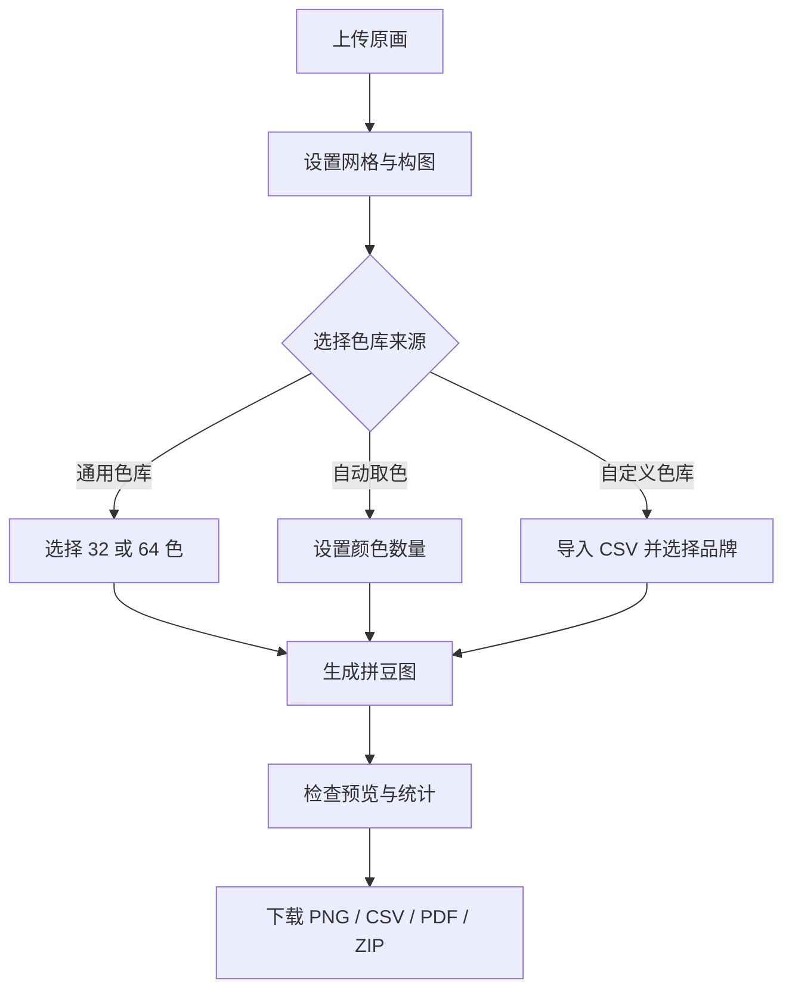

# 拼豆图生成器产品需求文档

> 文档版本：1.1
> 产品版本：当前 Python / Streamlit 实现  
> 文档状态：基线版  
> 更新日期：2026-09-06  
> 适用读者：产品、设计、开发、测试及项目维护人员

## 1. 文档目的

本文档定义“拼豆图生成器”的产品目标、用户范围、功能边界、交互流程、验收标准和后续规划。当前版本以本地运行的 Python 网页应用为交付形态，文档中的“已实现”均以仓库内 `app.py`、`core.py` 和相关测试为准。

## 2. 产品概述

### 2.1 产品定位

拼豆图生成器是一款在浏览器中操作、由本地 Python 进程完成计算的单用户工具。用户上传一幅画或照片，设置拼豆网格尺寸与颜色来源后，程序将原图转换为可照着摆放的拼豆图，并生成颜色用量和可打印图纸。

### 2.2 要解决的问题

- 普通图片不能直接用于拼豆制作，需要先像素化并限制颜色。
- 人工逐格选色效率低，且容易使用实体色库中不存在的颜色。
- 制作者需要知道每种色号的数量，才能备料和核对库存。
- 大尺寸图案不适合在一张 A4 纸上打印，需要自动分页和定位坐标。
- 不同拼豆品牌的色号体系不同，需要允许导入自己的品牌色库。

### 2.3 核心价值

1. 从原画到可执行图纸一次完成。
2. 将颜色限制在用户实际可购买或已拥有的色号范围内。
3. 同时提供屏幕预览、制作网格、用量统计和打印文件。
4. 默认在本机处理图片，不依赖外部图片处理服务。

## 3. 用户与使用场景

| 用户类型 | 主要目标 | 典型场景 | 关键输出 |
| --- | --- | --- | --- |
| 拼豆爱好者 | 将喜欢的图片转换为可制作图案 | 人像、动漫、宠物、风景和图标 | 彩色网格图、色号数量 |
| 手工作品制作者 | 控制尺寸、颜色和备料数量 | 定制订单、礼物、装饰画 | 品牌色号图、用量 CSV、分页 PDF |
| 教学或活动组织者 | 快速准备统一图纸 | 手工课、亲子活动、工作坊 | 清晰坐标图、可打印分页文件 |
| 图案设计维护者 | 建立可复用的品牌色库 | 多品牌拼豆或自有库存 | 自定义 CSV 色库、完整图纸包 |

## 4. 产品目标与非目标

### 4.1 当前版本目标

- 支持常见位图上传并正确处理 EXIF 方向。
- 将图片转换为 4-300 颗宽、4-300 颗高的拼豆网格。
- 支持内置通用色库、自动取色以及品牌/自定义色库。
- 使用感知颜色空间完成最近色匹配。
- 提供处理前后预览、坐标网格、色号和数量统计。
- 导出 PNG、CSV、Excel XLSX、A4 PDF 和完整 ZIP 图纸包。
- 在 Windows、macOS 和 Linux 上通过浏览器使用。

### 4.2 当前版本非目标

- 不提供逐格手工绘制、橡皮擦、填充或撤销功能。
- 不提供账号、云端项目、协作、作品库或跨设备同步。
- 不自动识别拼豆库存、价格或购买渠道。
- 不承诺内置通用色与任一实体品牌完全一致。
- 不处理视频；GIF 仅使用第一帧。
- 不提供自动抠图、主体检测或生成式图像增强。
- 不生成生产设备控制文件，也不控制自动摆豆设备。

## 5. 核心用户流程



## 6. 产品范围

### 6.1 输入

- 原画文件：JPG/JPEG、PNG、WEBP、BMP、TIF/TIFF、GIF；安装 `pillow-heif` 后支持 HEIC/HEIF。
- 单个上传文件最大 60 MB。
- 解码后图片最大 8000 万像素。
- 自定义色库文件：CSV，支持 UTF-8 BOM、GB18030 和 Big5 编码。

### 6.2 处理

- 目标宽高、原图比例、构图方式、透明区域底色。
- 对比度、饱和度。
- 色库生成或载入。
- Lab 感知色差最近邻匹配。
- 色号统计、网格渲染和分页。

### 6.3 输出

- 像素化预览图。
- 带坐标、网格和可选色号的 PNG 图纸。
- 颜色品牌、色号、名称、RGB、HEX、数量和占比 CSV。
- A4 分页 PDF。
- 含图纸、色表和生成设置的 ZIP 包。

## 7. 功能需求

优先级定义：P0 为当前版本必须满足；P1 为重要增强；P2 为后续可选能力。

### 7.1 图片输入与校验

| 编号 | 优先级 | 需求 | 验收标准 |
| --- | --- | --- | --- |
| FR-IMG-001 | P0 | 用户可以上传支持的位图文件 | 选择 JPG、PNG、WEBP、BMP、TIFF 或 GIF 后可显示原画；HEIC/HEIF 在对应依赖可用时可读取 |
| FR-IMG-002 | P0 | 程序应修正相机照片方向 | 带 EXIF 方向信息的图片按正确方向进入预览和处理流程 |
| FR-IMG-003 | P0 | 程序应阻止过大的输入 | 文件超过 60 MB 时提示压缩；解码尺寸超过 8000 万像素时拒绝处理并给出提示 |
| FR-IMG-004 | P0 | 更换原画后不得展示上一张图的结果 | 新文件哈希发生变化时清除旧结果，重新生成前只展示新原画 |
| FR-IMG-005 | P0 | 无效文件应产生可理解的错误 | 文件无法解码时显示支持格式说明，不导致应用退出 |

### 7.2 网格与构图

| 编号 | 优先级 | 需求 | 验收标准 |
| --- | --- | --- | --- |
| FR-GRID-001 | P0 | 用户可以设置横向拼豆数 | 可设置 4-300 颗，默认 50 颗，步长 1 |
| FR-GRID-002 | P0 | 用户可以按原画比例计算纵向拼豆数 | 开启比例锁定后，根据原图宽高比计算并限制在 4-300 颗 |
| FR-GRID-003 | P0 | 用户可以独立设置纵向拼豆数 | 关闭比例锁定后，可设置 4-300 颗，默认 50 颗 |
| FR-GRID-004 | P0 | 用户可以选择构图方式 | 提供“裁剪填满”“完整留白”“拉伸”三种方式，输出尺寸均严格等于目标网格 |
| FR-GRID-005 | P0 | 透明或留白区域可选择底色 | 颜色选择器接受六位 HEX，缺省为白色 |
| FR-GRID-006 | P0 | 用户可设置实体拼豆直径 | 范围 1.0-10.0 mm，步长 0.1 mm；用于计算成品尺寸，不改变图像网格 |
| FR-GRID-007 | P0 | 用户可调整对比度和饱和度 | 对比度范围 0.5-2.0；饱和度范围 0.0-2.0；生成结果反映当前数值 |

### 7.3 颜色来源与匹配

| 编号 | 优先级 | 需求 | 验收标准 |
| --- | --- | --- | --- |
| FR-PAL-001 | P0 | 提供内置通用色库 | 用户可选择覆盖主要色相的 32 色或 64 色屏幕参考色库 |
| FR-PAL-002 | P0 | 支持从原画自动取色 | 可选择 2-64 色；程序使用无抖动中位切分量化提取代表色并生成 A01、A02 等临时色号 |
| FR-PAL-003 | P0 | 支持导入品牌或自定义色号表 | 用户可上传 CSV；可使用 `hex` 列，或同时使用 `r`、`g`、`b` 三列 |
| FR-PAL-004 | P0 | CSV 支持中英文表头 | 接受 `brand/品牌`、`code/色号`、`name/名称`、`hex/颜色/color` 等字段别名 |
| FR-PAL-005 | P0 | 一个 CSV 可包含多个品牌 | 程序列出识别到的品牌；用户可选择一个或多个品牌参与匹配 |
| FR-PAL-006 | P0 | 色库必须有足够颜色 | 有效颜色不足两个，或筛选后不足两个时，阻止生成并显示原因 |
| FR-PAL-007 | P0 | 每个像素应匹配到最接近的可用色 | 将目标像素和色库颜色转为 Lab，按欧氏距离选择最小值；每个网格位置只产生一个色号 |
| FR-PAL-008 | P0 | 提供可下载的 CSV 模板 | 模板包含 `brand,code,name,hex` 及示例数据，可直接编辑后重新导入 |

### 7.4 预览与统计

| 编号 | 优先级 | 需求 | 验收标准 |
| --- | --- | --- | --- |
| FR-VIEW-001 | P0 | 页面应同时提供处理前后预览 | 上传后显示原画；生成后在相邻区域显示最近邻放大的拼豆预览 |
| FR-VIEW-002 | P0 | 页面应显示关键汇总指标 | 显示网格宽高、拼豆总数、实际使用颜色数和预计成品尺寸 |
| FR-VIEW-003 | P0 | 页面应显示颜色用量表 | 每个实际使用色显示色块、品牌、色号、名称、HEX、数量和百分比，并按数量降序排列 |
| FR-VIEW-004 | P0 | 页面应提供完整网格查看 | 网格带行列坐标，每 5 颗使用较粗分隔线，并根据设置显示或隐藏格内色号 |

### 7.5 导出

| 编号 | 优先级 | 需求 | 验收标准 |
| --- | --- | --- | --- |
| FR-OUT-001 | P0 | 导出彩色网格 PNG | 文件名为 `pattern_grid.png`，包含颜色、坐标、网格和可选色号 |
| FR-OUT-002 | P0 | 导出色号用量 CSV | 文件名为 `bead_usage.csv`，使用 UTF-8 BOM，可被常用表格软件直接打开 |
| FR-OUT-003 | P0 | 导出 A4 分页 PDF | 用户可选每页 25×35、30×40 或 40×55 格；PDF 包含汇总/色表页及所有网格分页 |
| FR-OUT-004 | P0 | 导出完整 ZIP 图纸包 | ZIP 至少包含网格 PNG、像素预览 PNG、用量 CSV、打印 PDF、所用色库 CSV 和 `settings.json` |
| FR-OUT-005 | P0 | CSV 应降低公式注入风险 | 以 `= + - @` 开头的品牌、色号、名称或 HEX 文本在导出时加前导单引号 |
| FR-OUT-006 | P0 | 导出 Excel 像素单元格图 | `bead_pattern.xlsx` 中的“拼豆图”从 A1 开始，转换后每颗拼豆恰好对应一个单元格；尺寸与索引矩阵一致，无插入图片或合并单元格 |
| FR-OUT-007 | P0 | Excel 保留颜色与可选色号 | 填充颜色与匹配后的色库 RGB 完全一致，近似方格，每 5 格加粗边界；色号按生成设置显示，保留前导零且不执行导入文本中的公式 |
| FR-OUT-008 | P0 | Excel 色号统计与打包 | 第二张表含品牌、色号、名称、HEX 与生成时数量快照；数量合计等于网格格数；ZIP 包含相同 XLSX 字节 |

## 8. 交互与页面状态

### 8.1 初始状态

- 主区域提示用户先上传原画。
- “生成拼豆图”按钮不可用。
- 左侧设置可见；依赖原图比例的纵向尺寸在上传后计算。

### 8.2 已上传、未生成

- 显示原画。
- 右侧提示调整设置并生成。
- 生成按钮可用；自定义色库模式下，缺少有效 CSV 时仍在生成阶段阻止执行。

### 8.3 生成成功

- 显示处理后预览与四项指标。
- 提供“彩色网格图”“色号与数量”“下载”三个标签页。
- 单项下载和完整 ZIP 下载同时可用。

### 8.4 错误状态

- 图片过大、格式无效、CSV 结构错误、RGB 越界或所选颜色不足时，在当前页面显示具体错误。
- 错误不得导致 Streamlit 进程退出。

## 9. 数据与文件规范

### 9.1 自定义色库 CSV

推荐格式：

```csv
brand,code,name,hex
我的品牌,A01,白色,#FFFFFF
我的品牌,A02,黑色,#18191C
```

RGB 格式：

```csv
brand,code,name,r,g,b
我的品牌,A01,白色,255,255,255
我的品牌,A02,黑色,24,25,28
```

约束：

- `hex` 为 3 位或 6 位十六进制颜色；可带 `#`。
- `r`、`g`、`b` 均为 0-255 的整数。
- `code` 缺失时自动生成 `C001`、`C002` 等色号。
- `name` 缺失时使用色号；`brand` 缺失时使用“自定义”。
- 空行忽略；少于两个有效颜色时拒绝导入。

### 9.2 用量 CSV 字段

| 字段 | 含义 |
| --- | --- |
| `brand` | 品牌或色库名称 |
| `code` | 色号 |
| `name` | 颜色名称 |
| `hex` | `#RRGGBB` 屏幕颜色 |
| `r`,`g`,`b` | RGB 分量 |
| `count` | 该色拼豆数量 |
| `percent` | 占全部网格的百分比 |

### 9.3 ZIP 内容

| 文件 | 用途 |
| --- | --- |
| `pattern_grid.png` | 带网格和色号的制作图 |
| `pixel_preview.png` | 无网格的像素化效果预览 |
| `bead_usage.csv` | 实际使用颜色和数量 |
| `printable_pattern.pdf` | A4 分页打印图纸 |
| `bead_pattern.xlsx` | 一像素一单元格的彩色拼豆图及色号统计 |
| `palette_used.csv` | 本次参与匹配的全部颜色 |
| `settings.json` | 本次网格、色库、构图及输出设置 |

## 10. 非功能需求

| 编号 | 领域 | 要求 | 验收方式 |
| --- | --- | --- | --- |
| NFR-001 | 隐私 | 本地使用时，图片不得发送到外部处理服务 | 断网状态下已安装依赖的应用仍可完成转换和导出 |
| NFR-002 | 兼容性 | 支持 Python 3.10+ 与主流桌面浏览器 | Windows、macOS、Linux 各完成一次启动和基础流程验证 |
| NFR-003 | 可维护性 | UI 与处理核心分离 | `app.py` 负责交互，`core.py` 可在不启动网页的情况下独立测试 |
| NFR-004 | 稳定性 | 合法输入应生成所有请求的文件 | 自动测试验证数组尺寸、总数、PNG 文件头和 PDF 文件头 |
| NFR-005 | 性能 | 颜色匹配不得一次构造无限大的距离矩阵 | 匹配按 4096 个像素分块；300×300 网格可在普通桌面环境完成 |
| NFR-006 | 内存 | 大网格 PNG 应限制最大渲染边长 | 单格尺寸根据网格自动下调，使主体边长约不超过 5200 像素 |
| NFR-007 | 可读性 | 深浅背景上的色号均应可辨认 | 根据颜色亮度自动选用深色或白色色号文字 |
| NFR-008 | 可访问性 | 主要输入和操作具有可见文字标签 | 上传、设置、生成和下载无需仅依靠颜色识别 |

## 11. 验收清单

### 11.1 主流程

1. 上传一张带 EXIF 方向的 JPG，原画方向正确。
2. 设置宽 60 颗并锁定比例，纵向尺寸自动变化。
3. 分别使用三种构图方式生成，输出宽高保持一致。
4. 使用 32 色、64 色、自动取色、自定义品牌色库各生成一次。
5. 检查预览、总数、使用颜色数和成品尺寸计算。
6. 检查网格坐标、每 5 格粗线及色号开关。
7. 下载 PNG、CSV、三种分页密度的 PDF 和 ZIP，并确认均可打开。

### 11.2 边界与异常

- 4×4 和 300×300 网格均可进入生成流程。
- 60 MB 以上文件被拒绝。
- 8000 万像素以上图片被拒绝。
- CSV 缺少颜色列、RGB 越界、只有一个有效颜色时给出明确错误。
- 自定义色库包含多个品牌时，筛选结果仅使用所选品牌。
- 更换上传图片后旧结果消失。

## 12. 风险与限制

| 风险或限制 | 影响 | 当前措施 |
| --- | --- | --- |
| 屏幕 RGB 与实体拼豆存在色差 | 成品颜色与屏幕预览不完全一致 | 内置色库标注为参考色；支持导入实测品牌色库 |
| 自动取色不对应可购买色号 | 用户仍需人工寻找近似拼豆 | 自动色明确使用临时 A 系列色号 |
| 大网格包含大量文字绘制 | 生成速度和内存占用增加 | 限制网格尺寸并动态降低 PNG 单格像素 |
| 色号过长 | 格内文字可能放不下 | PNG 截取前 5 字符，PDF 截取前 6 字符，完整色号保留在统计表 |
| PDF 使用便携英文字体 | 中文颜色名称不会完整出现在 PDF 色表中 | PDF 保留色块、色号、HEX 和数量；网页及 CSV 保留中文名称 |
| 设置变化后不会自动重新计算 | 页面可能暂时显示上一次结果 | 保留显式“生成拼豆图”操作；更换原画时强制清除旧结果 |
| GIF 只读取第一帧 | 动画内容丢失 | 上传说明中明确提示 |
| 纯色图的自动取色可能只得到一种颜色 | 当前匹配函数要求至少两个颜色，导致生成失败 | 可改用内置/自定义色库；后续允许单色色库或给出专门提示 |
| 自定义色库没有条目上限 | 极大 CSV 会拖慢匹配，并可能超过当前索引类型容量 | 当前要求使用正常规模色库；后续增加条目上限和重复项检查 |
| 300×300 网格分页量很大 | 25×35 规格会产生 108 个网格页，生成和打印成本高 | 提供三种分页密度；后续增加预计页数警告 |
| 生成文件全部驻留会话内存 | 大网格会同时保存多个二进制副本 | PNG 自动降低单格像素；后续考虑按需或流式生成 |
| 生成失败后可能保留上一次成功结果 | 用户可能误下载与当前参数不一致的文件 | 更换原画会清除；后续增加参数指纹及结果过期状态 |

## 13. 成功指标建议

以下指标需要在引入匿名统计或用户调研后才能采集，当前版本不自动上报数据：

- 上传后成功生成率。
- 生成后至少下载一个文件的比例。
- 自定义品牌色库导入成功率。
- 用户第一次获得可制作图纸所需时间。
- 因颜色不匹配、色号不可读或分页困难导致的返工率。

## 14. 后续规划

### P1：制作效率增强

- 逐格编辑、画笔、橡皮擦、区域填充、撤销/重做。
- 固定或替换某个颜色，合并近似色。
- 保存可继续编辑的项目文件。
- 支持透明格/空格，不强制为背景拼豆。
- PDF 嵌入中文字体并增加分页拼接标记。
- 生成前显示预计页数、图片尺寸和内存提示。
- 限制并诊断自定义色库条目数、重复色号和重复 RGB。
- 允许单色自动图案，统一处理仅提取到一种颜色的情况。
- 所有 PDF 分页使用一致单格尺寸，并增加页序总览。

### P2：专业色彩与工作流

- 基于实体色卡照片的颜色校准。
- CIEDE2000 色差、可选抖动算法和边缘增强。
- 拼豆库存核对、缺料清单和成本估算。
- 批量转换、模板尺寸和常用品牌色库管理。
- 独立桌面安装包或受控的在线部署版本。
- 在 `settings.json` 中补充自动取色数量、PNG 单格尺寸、源文件标识和应用版本。

## 15. 版本发布判定

当前版本达到发布基线的条件：所有 P0 需求完成；核心自动测试通过；网页初始渲染无异常；至少用一张样例图验证 PNG、CSV、PDF 和 ZIP；README 中的 Windows 与 macOS/Linux 启动步骤可执行。
